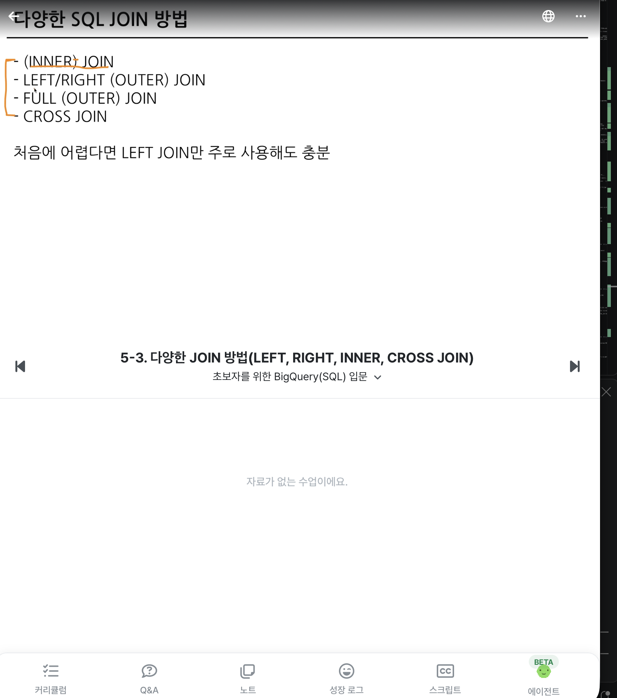
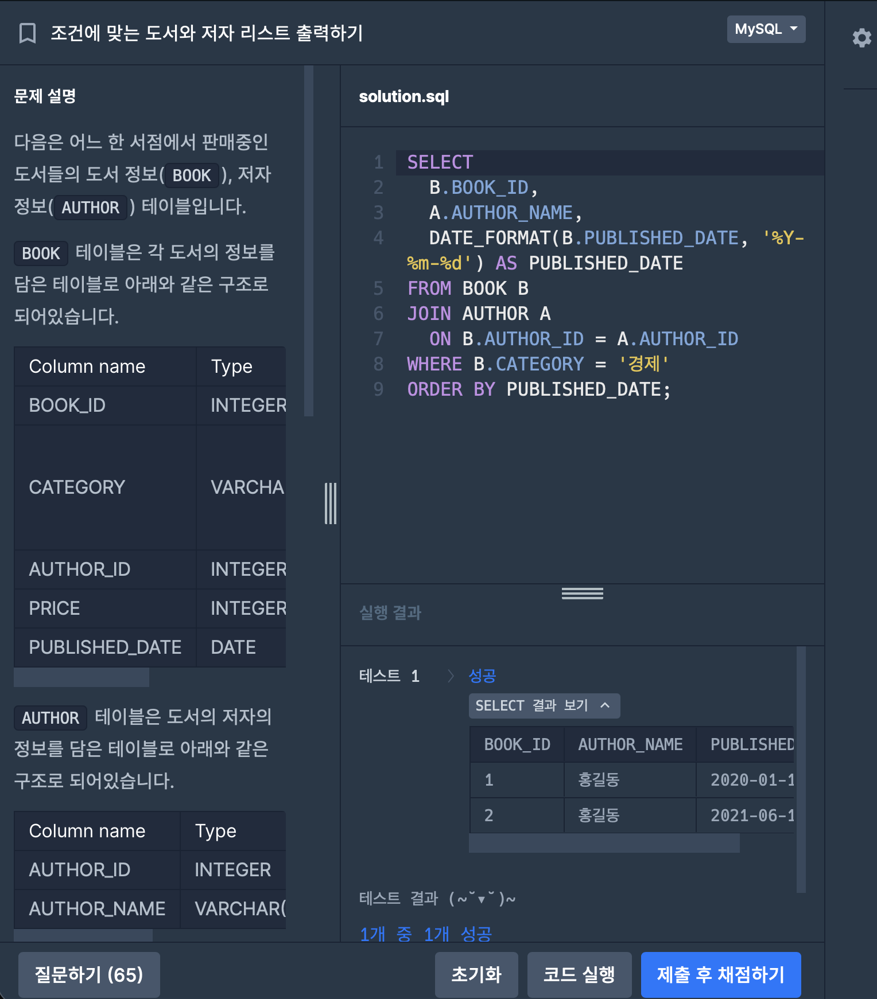
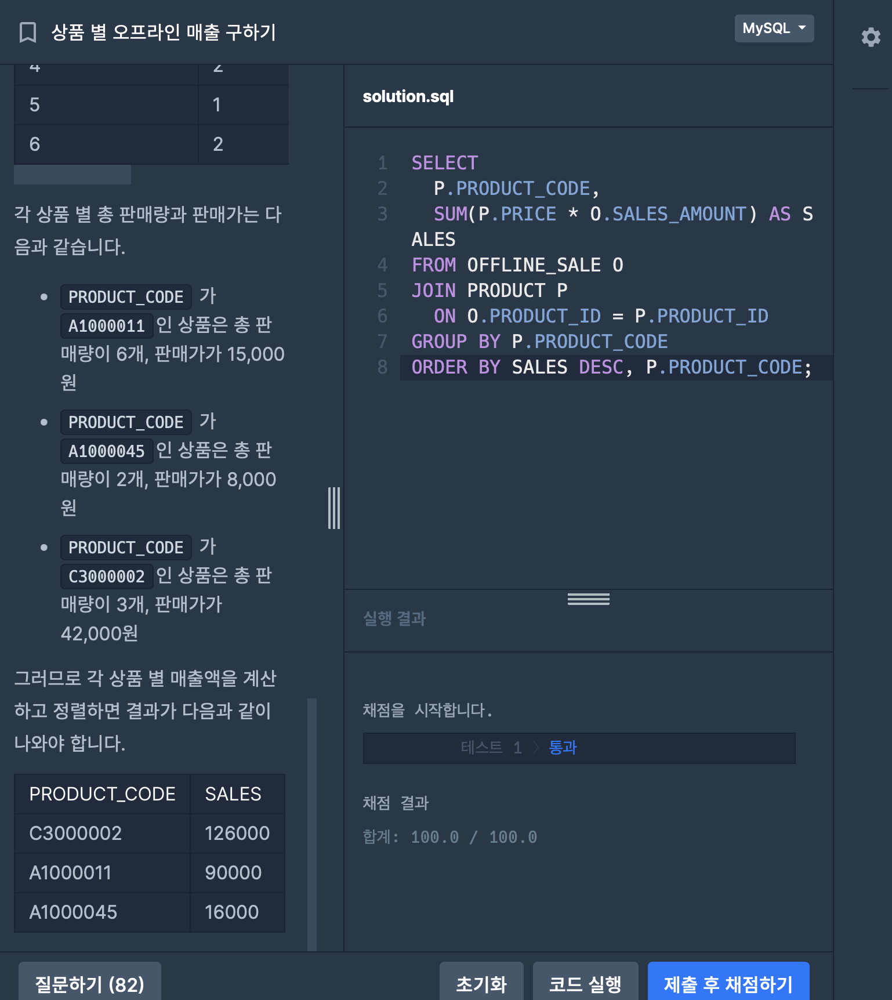
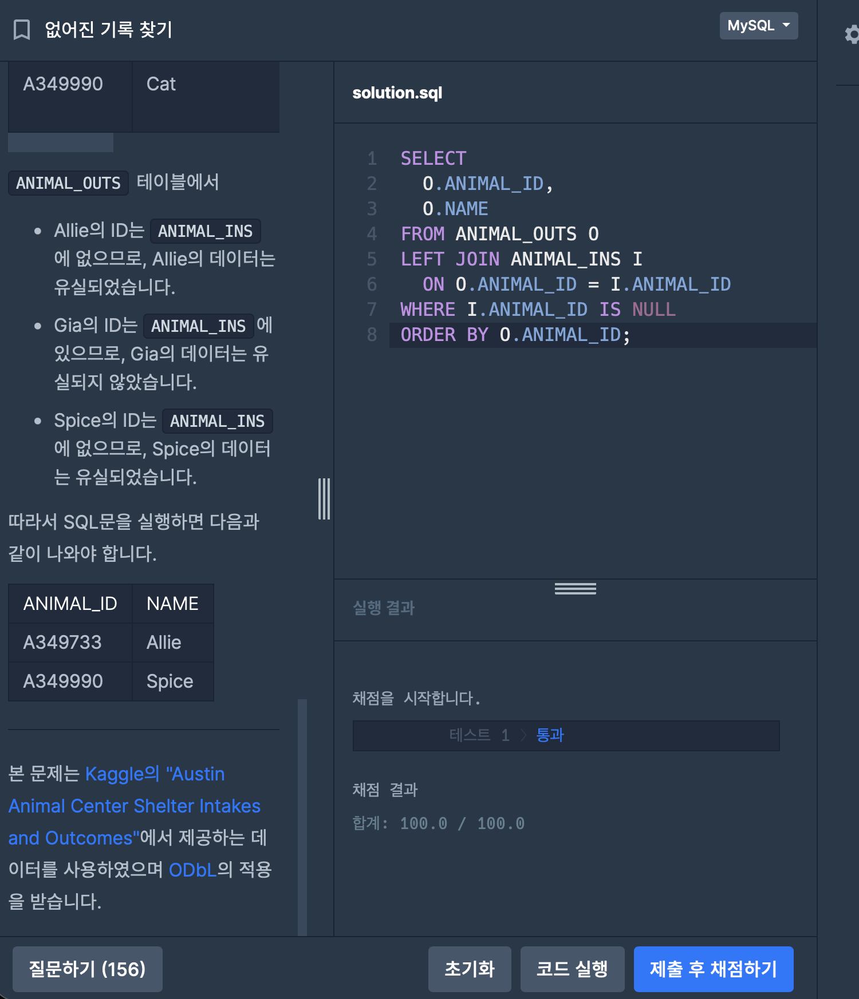
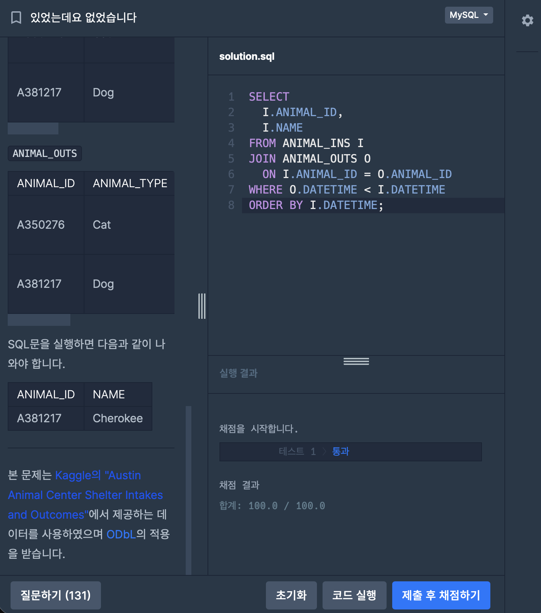

# 📘 SQL_BASIC 6주차 정규 과제

SQL_BASIC 정규 과제는 매주 정해진 분량의 `초보자를 위한 BigQuery(SQL) 입문` 강의를 듣고, 핵심 개념을 정리한 뒤 간단한 SQL 문제를 직접 풀어보는 방식으로 진행합니다.

이번 주는 SQL 입문 과정의 핵심 고비인 `JOIN`을 학습합니다.

JOIN은 여러 테이블을 연결해서 분석 질문에 답하기 위해 반드시 필요한 개념입니다. 이번 주 과제에서는 정답 코드뿐 아니라 **어떤 테이블을 어떤 키로 연결했는지**를 꼭 기록해주세요.

완성된 과제는 Github에 업로드하고, 링크를 스프레드시트 'SQL' 시트에 입력해 제출해주세요.

**👀 수행 인증란은 필수입니다.**

---

## 📚 SQL_BASIC_6th_TIL

### 섹션 6. 다량의 자료를 연결 : JOIN

### 5-2. JOIN 이해하기

### 5-3. 다양한 JOIN 방법

### 5-4. JOIN 쿼리 작성하기

### 5-5. JOIN을 처음 공부할 때 헷갈리는 부분

---

## ✨ 선택 강의

- 5-6. JOIN 연습문제: JOIN 문제를 더 연습하고 싶을 때 선택 수강

---

## 🏁 전체 강의 수강 계획

| 주차 | 필수 강의 범위 | 선택 강의 | 완료 여부 |
| --- | --- | --- | --- |
| 1주차 | 1-1 ~ 2-1 | 1 | ✅ |
| 2주차 | 2-2 ~ 2-3 | 2-4 | ✅ |
| 3주차 | 2-5, 2-7 ~ 2-8 | 2-6 | ✅ |
| 4주차 | 3-2 ~ 4-3 | 3-4 | ✅ |
| 5주차 | 4-4 ~ 4-6 | 4-5, 4-7 | ✅ |
| 6주차 | 5-2 ~ 5-5 | 5-6 | ✅ |
| 7주차 | 필수 강의 없음 | 6-2, 6-3, 6-4, 6-5 | 🍽️ |

---

<br>

<!-- 여기까진 그대로 둬 주세요-->

---

# 1️⃣ 개념 정리

아래 키워드 중 중요하다고 생각한 개념을 2개 이상 골라 짧게 정리해주세요. 3개보다 더 많이 정리하고 싶다면 자유롭게 항목을 추가해도 좋습니다.

이번 주 키워드:
- JOIN
- INNER JOIN
- LEFT JOIN
- JOIN key
- alias
- NULL
- 다중 JOIN

## 01.

```
개념 이름: JOIN과 JOIN key
개념 설명:
- JOIN: 서로 다른 테이블을 연결하는 문법
- JOIN key: 두 테이블이 공통으로 가진 컬럼. 보통 id를 key로 쓰고, 날짜 같은 범위로도 연결할 수 있음
- 컬럼 이름이 달라도 값의 의미가 같으면 key가 됨 (trainer_pokemon.trainer_id = trainer.id)
- JOIN이 필요한 이유: 데이터베이스는 정규화를 거쳐 중복을 줄이도록 설계됨
  → User 테이블엔 유저 정보만, Order 테이블엔 주문 정보만 저장하고, 필요할 때 JOIN해서 씀
  → 분석에선 미리 합쳐둔 테이블이 편하므로 데이터 웨어하우스에서 JOIN한 "데이터 마트"를 만들어 씀
- trainer와 pokemon은 공통 값이 없어 바로 연결할 수 없음. 둘을 이어주는 trainer_pokemon 테이블을 통해 연결

JOIN 쿼리 작성 흐름:
1. 테이블 확인: 저장된 데이터, 컬럼 확인
2. 기준(base) 테이블 정하기
3. JOIN key 찾기: 각 테이블과 연결할 key(ON) 정리
4. 결과 예상하기: 결과 테이블을 손이나 엑셀로 미리 그려보기 (정답지 역할)
5. 쿼리 작성 / 검증: 예상한 결과와 같은지 확인

예시 쿼리:
SELECT
  tp.*,
  t.* EXCEPT(id),   -- id 컬럼이 겹치므로 제외 (tp.trainer_id로 대신 확인)
  p.* EXCEPT(id)
FROM basic.trainer_pokemon AS tp
LEFT JOIN basic.trainer AS t
ON tp.trainer_id = t.id     -- ON 뒤에 JOIN key를 작성
LEFT JOIN basic.pokemon AS p
ON tp.pokemon_id = p.id
```

## 02.

```
개념 이름: JOIN 종류 (INNER / LEFT / RIGHT / FULL / CROSS)
개념 설명:
Table A = (1 가), (2 나), (3 다) / Table B = (1 A), (2 B), (4 C) 를 key로 연결하면

1. INNER JOIN: 두 테이블에 모두 있는 key만 연결 (교집합)
   → (1 가 A), (2 나 B)
2. LEFT JOIN: 왼쪽 테이블의 모든 행을 남기고, 오른쪽에 짝이 없으면 NULL
   → (1 가 A), (2 나 B), (3 다 NULL)
3. RIGHT JOIN: 오른쪽 테이블 기준. 왼쪽에 짝이 없으면 NULL
   → (1 가 A), (2 나 B), (4 NULL C)
4. FULL JOIN: 양쪽 행을 모두 남김
   → (1 가 A), (2 나 B), (3 다 NULL), (4 NULL C)
5. CROSS JOIN: 모든 행끼리 조합 (3 × 3 = 9행). ON을 쓰지 않음

- INNER / LEFT / RIGHT / FULL JOIN은 ON이 필수, CROSS JOIN만 ON이 없음
- 처음엔 LEFT JOIN 하나를 주로 써도 충분. 기준 테이블을 왼쪽에 두고 오른쪽에 데이터를 붙여 나감

예시 쿼리:
SELECT
  col
FROM table_a AS A
INNER JOIN table_b AS B    -- LEFT / RIGHT / FULL JOIN도 같은 형태
ON A.key = B.key
```

## (선택) 03.

```
개념 이름: alias, NULL, 다중 JOIN
개념 설명:
- alias(별칭): FROM basic.trainer_pokemon AS tp 처럼 테이블에 짧은 이름을 붙임.
  여러 테이블에 같은 컬럼 이름(id 등)이 있을 때 tp.id, t.id로 어느 테이블 컬럼인지 구분
- NULL: 값이 없음, 알 수 없음. 0이나 공백('')과 달리 값 자체가 없는 상태.
  JOIN에서는 연결할 짝이 없을 때 나타남. 비교는 = NULL이 아니라 IS NULL / IS NOT NULL
- 다중 JOIN: JOIN 개수에 제한은 없음. LEFT JOIN ... ON ... 을 이어서 쓰면 됨.
  다만 너무 많이 JOIN하고 있지 않은지는 확인
- 컬럼 선택: 처음엔 JOIN이 잘 되었는지 보려고 * 로 많이 봐도 되지만,
  BigQuery는 읽은 컬럼만큼 비용이 나오므로 안 쓰는 컬럼은 빼기. id는 Unique 확인용으로 자주 남김

헷갈린 점:
- 어떤 JOIN을 쓸지: 목적에 따라 고름. 교집합이면 INNER, 모든 조합이면 CROSS, 그 외엔 LEFT
- 어떤 테이블을 왼쪽에 둘지: LEFT JOIN에선 기준이 되는 테이블을 왼쪽(FROM)에 둔다
- trainer와 pokemon의 id는 이름만 같고 의미가 다름. 그래서 t.id = p.id 로 연결하면 안 되고
  trainer_pokemon의 trainer_id, pokemon_id를 거쳐 연결해야 함
```

---

# 2️⃣ 수행 인증란

아래 중 하나 이상을 첨부해주세요.

- 강의 수강 화면 캡처
- JOIN 문제 풀이 정답 화면 캡처
- JOIN 전후 결과 row 수를 비교한 캡처 또는 메모

**JOIN 전후 row 수 비교 메모** (강의 dataset CSV 기준)

| 쿼리 | row 수 | 메모 |
| --- | --- | --- |
| trainer | 89 | |
| pokemon | 251 | |
| trainer_pokemon | 379 | 기준 테이블 |
| trainer_pokemon LEFT JOIN trainer LEFT JOIN pokemon | 379 | 기준 테이블과 같음. key가 trainer.id, pokemon.id로 Unique해서 행이 늘지 않음 |
| 위와 같은 연결을 INNER JOIN으로 | 379 | 모든 trainer_id, pokemon_id가 짝이 있어서 LEFT와 결과가 같음 |
| pokemon LEFT JOIN trainer_pokemon | 464 | 251보다 늘어남. 여러 번 잡힌 포켓몬은 행이 복제되고, 한 번도 안 잡힌 85마리는 NULL 행으로 남음 |
| trainer CROSS JOIN pokemon | 22,339 | 89 × 251 |

→ 어느 테이블을 기준(왼쪽)으로 두느냐, key가 Unique한지에 따라 결과 row 수가 달라짐

<!-- 강의 수강 화면 또는 BigQuery 실행 결과 캡처를 여기에 첨부해주세요 -->

---

# 3️⃣ 확인 문제

프로그래머스는 로그인이 필요하므로, 로그인 후 문제 풀이를 진행해주세요.

## 🧩 문제 1


문제 링크: [조건에 맞는 도서와 저자 리스트 출력하기](https://school.programmers.co.kr/learn/courses/30/lessons/144854)

풀이 과정:

```
- 사용한 테이블: BOOK(도서), AUTHOR(저자)
- JOIN key: BOOK.AUTHOR_ID = AUTHOR.AUTHOR_ID (INNER JOIN, 모든 도서에 저자가 있으므로 교집합으로 충분)
- 날짜를 출력한 형식: DATE_FORMAT(PUBLISHED_DATE, '%Y-%m-%d') → 예: 2021-01-01
```

```sql
SELECT
  B.BOOK_ID,
  A.AUTHOR_NAME,
  DATE_FORMAT(B.PUBLISHED_DATE, '%Y-%m-%d') AS PUBLISHED_DATE
FROM BOOK B
JOIN AUTHOR A
  ON B.AUTHOR_ID = A.AUTHOR_ID
WHERE B.CATEGORY = '경제'
ORDER BY PUBLISHED_DATE;
```

- 처음에 TO_CHAR(Oracle 함수)로 제출해서 MySQL에서 런타임 에러가 남 → MySQL은 DATE_FORMAT 사용

## 🧩 문제 2

문제 링크: [상품 별 오프라인 매출 구하기](https://school.programmers.co.kr/learn/courses/30/lessons/131533)

풀이 과정:


```
- 연결한 테이블: OFFLINE_SALE(판매 기록, 기준) + PRODUCT(상품 정보: 상품코드, 판매가)
- JOIN key: OFFLINE_SALE.PRODUCT_ID = PRODUCT.PRODUCT_ID
- 집계한 값: 매출액 = 판매가 × 판매량 → SUM(P.PRICE * O.SALES_AMOUNT)을 PRODUCT_CODE별로 GROUP BY
  정렬은 매출액 내림차순, 같으면 상품코드 오름차순
```

```sql
SELECT
  P.PRODUCT_CODE,
  SUM(P.PRICE * O.SALES_AMOUNT) AS SALES
FROM OFFLINE_SALE O
JOIN PRODUCT P
  ON O.PRODUCT_ID = P.PRODUCT_ID
GROUP BY P.PRODUCT_CODE
ORDER BY SALES DESC, P.PRODUCT_CODE;
```

## 🧩 문제 3

문제 링크: [없어진 기록 찾기](https://school.programmers.co.kr/learn/courses/30/lessons/59042)

풀이 과정:


```
- 기준이 되는 왼쪽 테이블: ANIMAL_OUTS(입양 기록). JOIN key는 ANIMAL_ID
- LEFT JOIN이 필요한 이유: "입양 기록은 있는데 보호소 들어온 기록이 없는" 동물을 찾아야 함.
  INNER JOIN은 양쪽에 다 있는 동물만 남기므로 찾는 동물이 사라짐.
  LEFT JOIN은 입양 기록을 모두 남기고, 들어온 기록이 없으면 오른쪽(ANIMAL_INS) 컬럼을 NULL로 채움
- NULL이 발생하는 경우: ANIMAL_INS에 해당 ANIMAL_ID가 없을 때 → WHERE I.ANIMAL_ID IS NULL로 골라냄
```

```sql
SELECT
  O.ANIMAL_ID,
  O.NAME
FROM ANIMAL_OUTS O
LEFT JOIN ANIMAL_INS I
  ON O.ANIMAL_ID = I.ANIMAL_ID
WHERE I.ANIMAL_ID IS NULL
ORDER BY O.ANIMAL_ID;
```

## 🧩 문제 4

문제 링크: [있었는데요 없었습니다](https://school.programmers.co.kr/learn/courses/30/lessons/59043)

풀이 과정:

```
- 사용한 테이블: ANIMAL_INS(보호 시작), ANIMAL_OUTS(입양)
- JOIN key: ANIMAL_INS.ANIMAL_ID = ANIMAL_OUTS.ANIMAL_ID
  (양쪽 기록이 모두 있어야 날짜를 비교할 수 있으므로 INNER JOIN)
- 비교한 날짜 컬럼: 두 테이블의 DATETIME. 입양일이 보호 시작일보다 빠른 경우 → O.DATETIME < I.DATETIME
  두 테이블 컬럼 이름이 같아서 alias(I, O)로 구분해야 함
- 정렬 기준: 보호 시작일(I.DATETIME) 오름차순
```

```sql
SELECT
  I.ANIMAL_ID,
  I.NAME
FROM ANIMAL_INS I
JOIN ANIMAL_OUTS O
  ON I.ANIMAL_ID = O.ANIMAL_ID
WHERE O.DATETIME < I.DATETIME
ORDER BY I.DATETIME;
```

---

# 4️⃣ 참고 자료

JOIN 개념이 헷갈린다면 아래 자료를 함께 참고해도 좋습니다.

1. https://data-marketing-bk.tistory.com/entry/SQL-JOIN-%ED%95%9C-%EB%B0%A9%EC%97%90-%EC%A0%95%EB%A6%AC-%EA%B0%9C%EB%85%90%EB%B6%80%ED%84%B0-%EC%BD%94%EB%93%9C%EA%B9%8C%EC%A7%80-%EC%9D%B4%EA%B2%83%EB%A7%8C-%EB%B3%B4%EC%9E%90
2. https://velog.io/@wijoonwu/JOIN

---

# 5️⃣ 이번 주 회고

```
1. INNER JOIN과 LEFT JOIN의 차이를 어떻게 이해했는지: INNER JOIN은 양쪽에 모두 있는 key만 남기는 교집합이고, LEFT JOIN은 왼쪽 테이블 행을 전부 남기고 짝이 없으면 오른쪽을 NULL로 채움. 그래서 "없는 것"을 찾는 문제(없어진 기록 찾기)는 LEFT JOIN + IS NULL로 풀고, 양쪽 값을 비교하는 문제(있었는데요 없었습니다)는 INNER JOIN으로 풀었음
2. JOIN 문제를 풀 때 가장 먼저 확인해야 할 것: 기준 테이블이 무엇인지, 두 테이블을 잇는 key가 무엇인지. 컬럼 이름이 같아도 의미가 다를 수 있고(trainer.id와 pokemon.id), 이름이 달라도 같은 값일 수 있음(trainer_pokemon.trainer_id와 trainer.id)
3. JOIN 결과가 예상과 달랐던 경험이 있다면: pokemon을 기준으로 trainer_pokemon을 LEFT JOIN했더니 251행이 아니라 464행이 나옴. 한 포켓몬이 여러 번 잡히면 행이 복제되고, 한 번도 안 잡힌 포켓몬은 NULL 행으로 남기 때문. JOIN 후에는 row 수를 꼭 확인해야겠다고 느꼈음
```

수고하셨습니다!


