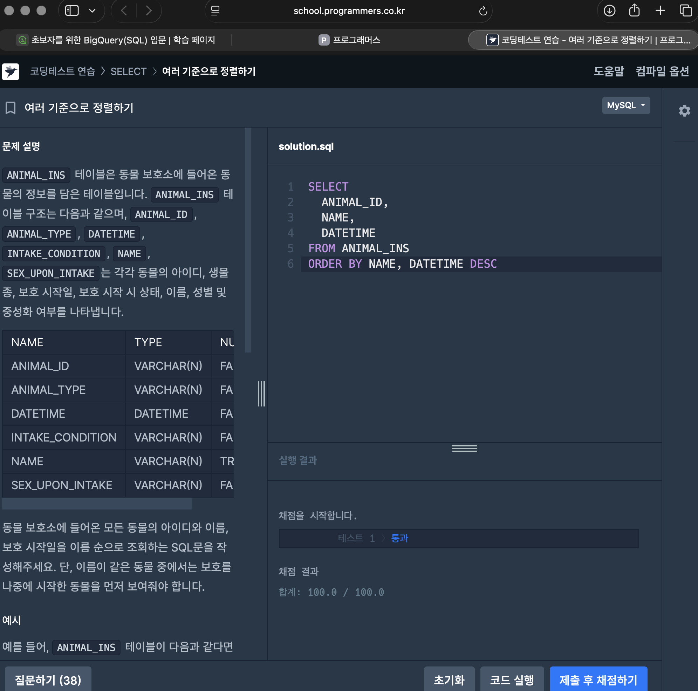
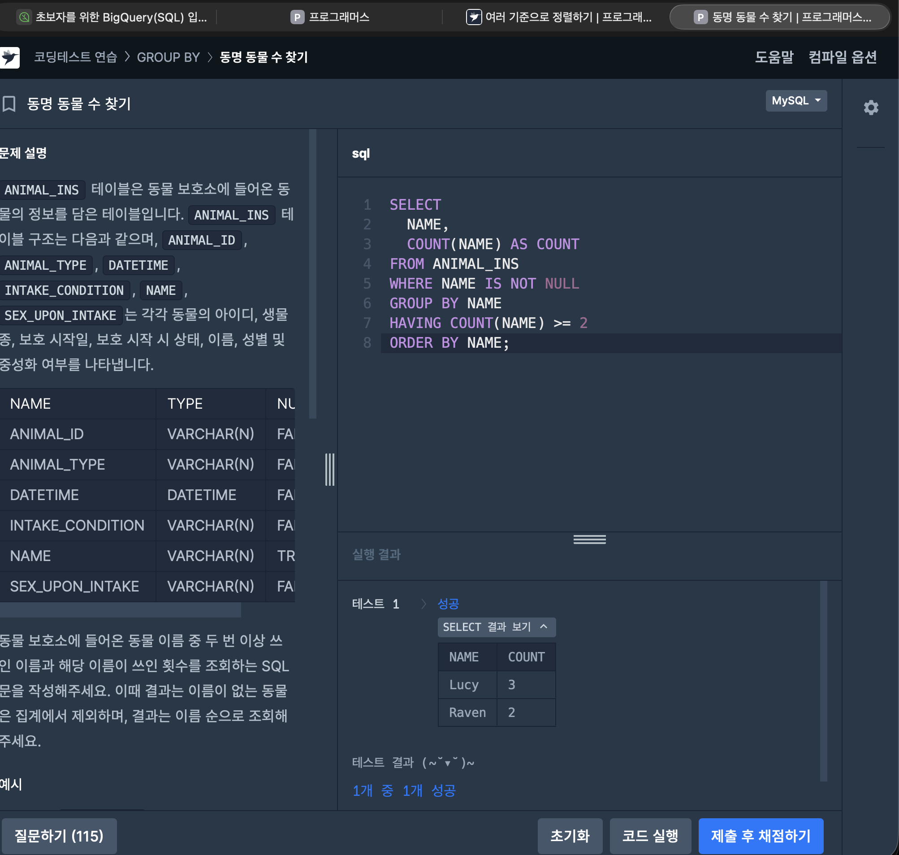

# 📘 SQL_BASIC 7주차 정규 과제

이번 주 필수 강의는 없습니다.

이번 주는 지금까지 배운 SQL 내용을 가볍게 복습하는 것으로 마무리합니다. 문제 풀이보다 중요한 것은 **내가 어떤 SQL 개념을 익혔고, 아직 어떤 부분이 헷갈리는지 정리하는 것**입니다.

완성된 과제는 Github에 업로드하고, 링크를 스프레드시트 'SQL' 시트에 입력해 제출해주세요.

**👀 수행 인증란은 필수입니다.**

---

## 📚 SQL_BASIC_7th_REVIEW

---

## ✨ 선택 강의

- 6-2. 가독성을 챙기기 위한 SQL 스타일 가이드: SQL을 더 읽기 좋게 작성하고 싶을 때 선택 수강
- 6-3. 가독성을 챙기기 위한 WITH 문 & 파티션: WITH 문과 파티션 개념을 가볍게 살펴보고 싶을 때 선택 수강
- 6-4. 데이터 결과 검증 정의: 쿼리 결과를 검증하는 관점을 알고 싶을 때 선택 수강
- 6-5. 데이터 결과 검증 예시: 결과 검증 사례를 확인하고 싶을 때 선택 수강

---

## 🏁 전체 강의 수강 계획

| 주차 | 필수 강의 범위 | 선택 강의 | 완료 여부 |
| --- | --- | --- | --- |
| 1주차 | 1-1 ~ 2-1 | 1 | ✅ |
| 2주차 | 2-2 ~ 2-3 | 2-4 | ✅ |
| 3주차 | 2-5, 2-7 ~ 2-8 | 2-6 | ✅ |
| 4주차 | 3-2 ~ 4-3 | 3-4 | ✅ |
| 5주차 | 4-4 ~ 4-6 | 4-5, 4-7 | ✅ |
| 6주차 | 5-2 ~ 5-5 | 5-6 | ✅ |
| 7주차 | 필수 강의 없음 | 6-2, 6-3, 6-4, 6-5 | ✅ |

---

<br>

<!-- 여기까진 그대로 둬 주세요-->

---

## 🔁 복습할 개념

- SELECT, FROM, WHERE
- ORDER BY, LIMIT
- GROUP BY, HAVING
- COUNT, SUM, AVG, MAX, MIN
- 문자열 함수
- 날짜/시간 함수
- CASE WHEN
- JOIN

---

# 1️⃣ 전체 개념 복습

아래 키워드 중 중요하다고 생각한 개념을 2개 이상 골라 짧게 정리해주세요. 3개보다 더 많이 정리하고 싶다면 자유롭게 항목을 추가해도 좋습니다.

복습 키워드:
- SELECT
- WHERE
- GROUP BY
- HAVING
- 문자열 함수
- 날짜/시간 함수
- CASE WHEN
- JOIN

## 01.

```
개념 이름: WHERE, GROUP BY, HAVING (쿼리 실행 순서)
개념 설명:
- 쓰는 순서: SELECT → FROM → WHERE → GROUP BY → HAVING → ORDER BY → LIMIT
- 실행 순서: FROM → WHERE → GROUP BY → HAVING → SELECT → ORDER BY → LIMIT
- WHERE: GROUP BY 전에 실행 → 원본 테이블의 "행"에 거는 조건. 집계 함수(COUNT 등)를 쓸 수 없음
- GROUP BY: 같은 값을 가진 행끼리 묶음. 묶은 뒤에는 기준 컬럼과 집계 값(COUNT, SUM, AVG, MAX, MIN)만 남음
  → SELECT에는 GROUP BY 기준 컬럼과 집계 함수만 쓸 수 있고, SELECT *는 쓸 수 없음
- HAVING: GROUP BY 후에 실행 → 집계가 끝난 "그룹"에 거는 조건 (예: COUNT(*) >= 2)
- SELECT는 앞 단계를 거치고 남은 것 중 무엇을 보여줄지 정하는 단계
- ORDER BY는 SELECT 다음에 실행되므로 SELECT에서 만든 별칭(alias)으로 정렬 가능
  (WHERE에서는 SELECT의 별칭을 쓸 수 없음)

예시 쿼리:
-- 1세대 포켓몬 중 type1별 포켓몬 수가 10마리 이상인 타입만, 많은 순으로
SELECT
  type1,
  COUNT(id) AS pokemon_cnt,
  ROUND(AVG(total), 1) AS avg_total
FROM basic.pokemon
WHERE generation = 1          -- 행 조건 (그룹 만들기 전)
GROUP BY type1
HAVING pokemon_cnt >= 10      -- 그룹 조건 (집계 후). MySQL은 COUNT(id) >= 10으로 써도 됨
ORDER BY pokemon_cnt DESC
```

## 02.

```
개념 이름: CASE WHEN (조건에 따라 새 값 만들기)
개념 설명:
- 조건에 따라 다른 값을 돌려주는 문법. 범주 나누기, 값 바꾸기(영문 → 한글), 조건부 집계에 사용
- 형태: CASE WHEN 조건1 THEN 값1 WHEN 조건2 THEN 값2 ELSE 기본값 END AS 컬럼명
- 위에서부터 차례로 검사하고, 처음 만족한 조건의 값을 돌려줌 → 좁은 조건을 위에 써야 함
- ELSE가 없으면 어느 조건에도 안 맞는 행은 NULL
- END를 빠뜨리면 문법 오류
- 조건이 하나면 IF(조건, 참일 때 값, 거짓일 때 값)로 간단하게 쓸 수 있음
- 집계 함수 안에 넣으면 조건부 집계가 됨: SUM(CASE WHEN ... THEN 1 ELSE 0 END)
  (BigQuery는 COUNTIF(조건)도 가능)

예시 쿼리:
-- total 기준으로 등급을 나누고, 등급별 포켓몬 수와 전설 포켓몬 수 세기
SELECT
  CASE
    WHEN total <= 300 THEN 'Low'
    WHEN total <= 500 THEN 'Medium'   -- 301~500 (위에서 300 이하는 이미 걸러짐)
    ELSE 'High'
  END AS total_grade,
  COUNT(id) AS pokemon_cnt,
  SUM(CASE WHEN is_legendary THEN 1 ELSE 0 END) AS legendary_cnt
FROM basic.pokemon
GROUP BY total_grade
ORDER BY pokemon_cnt DESC
```

## (선택) 03.

```
개념 이름: 문자열 함수와 날짜/시간 함수
개념 설명:
- 문자열 함수
  - CONCAT(a, b): 문자열 이어 붙이기
  - LIKE '%키워드%': 키워드 포함 여부 (%는 0글자 이상 아무 문자)
  - SPLIT(문자열, 구분자) / SUBSTR(문자열, 시작, 길이) / UPPER, LOWER / REPLACE
- 날짜/시간 함수
  - 타입: DATE(날짜), DATETIME(날짜+시간), TIMESTAMP(UTC 기준 시점)
  - 날짜 추출: EXTRACT(YEAR FROM 날짜), DATE(datetime)
  - 날짜 차이: BigQuery DATE_DIFF(끝, 시작, DAY) / MySQL DATEDIFF(끝, 시작)
  - 날짜 형식: BigQuery FORMAT_DATE('%Y-%m-%d', 날짜) / MySQL DATE_FORMAT(날짜, '%Y-%m-%d')
  - 날짜 자르기: DATE_TRUNC(날짜, MONTH) → 월별 집계에 사용

아직 헷갈리는 점:
- DB마다 함수 이름과 인자 순서가 다름. 강의는 BigQuery, 프로그래머스는 MySQL이라
  BigQuery 문법(FORMAT_DATE, DATE_DIFF)이나 Oracle 함수(TO_CHAR)를 그대로 쓰면 에러가 남
  → 문제를 풀기 전에 어떤 DB인지 먼저 확인하기
- DATEDIFF로 대여 기간을 셀 때 시작일을 포함하면 +1을 해야 하는지처럼, 문제가 요구하는 기준을 매번 확인해야 함
- TIMESTAMP는 UTC 기준이라 한국 시간으로 보려면 DATETIME(timestamp, 'Asia/Seoul')처럼 시간대를 지정해야 함
- 문자열 타입 이름도 DB마다 다름 (BigQuery STRING, MySQL CHAR/VARCHAR)
```

---

# 2️⃣ 수행 인증란

아래 중 하나 이상을 첨부해주세요.

- 복습 문제 정답 화면 캡처
- SQL 실행 결과 화면 캡처
- 전체 개념 정리 노트 캡처
! [alt text](image-24.png)  
---

# 3️⃣ 복습 문제

프로그래머스는 로그인이 필요하므로, 로그인 후 문제 풀이를 진행해주세요.

## 🧩 문제 1

문제 링크: [여러 기준으로 정렬하기](https://school.programmers.co.kr/learn/courses/30/lessons/59404)

풀이 과정:

```
- 문제 요구사항: ANIMAL_INS 테이블에서 모든 동물의 아이디(ANIMAL_ID), 이름(NAME), 보호 시작일(DATETIME)을
  이름 순으로 조회. 이름이 같은 동물 중에서는 보호를 나중에 시작한 동물을 먼저 보여줘야 함
- 첫 번째 정렬 기준: NAME 오름차순 (ASC는 기본값이라 생략 가능)
- 두 번째 정렬 기준: DATETIME 내림차순 (DESC) → 이름이 같을 때만 적용됨
- 복습한 점: ORDER BY에 컬럼을 콤마로 이어 쓰면 앞 기준이 같은 행끼리만 다음 기준으로 정렬함.
  ASC/DESC는 컬럼마다 따로 붙여야 함 (ORDER BY NAME, DATETIME DESC에서 DESC는 DATETIME에만 적용)
```

```sql
SELECT
  ANIMAL_ID,
  NAME,
  DATETIME
FROM ANIMAL_INS
ORDER BY NAME, DATETIME DESC;
```



## 🧩 문제 2

문제 링크: [동명 동물 수 찾기](https://school.programmers.co.kr/learn/courses/30/lessons/59041)

풀이 과정:

```
- 그룹화 기준: NAME (같은 이름끼리 묶어서 이름별 동물 수를 셈)
- 제외해야 하는 값: 이름이 없는 동물 (NAME IS NULL) → WHERE NAME IS NOT NULL
  (= NULL이 아니라 IS NULL / IS NOT NULL로 비교해야 함)
- HAVING 조건: COUNT(NAME) >= 2 → 두 번 이상 쓰인 이름만 남김
- 복습한 점: "이름 없는 동물 제외"는 그룹을 만들기 전 행 조건이라 WHERE,
  "두 번 이상 쓰인 이름"은 집계 후 그룹 조건이라 HAVING에 써야 함.
  COUNT(컬럼)은 NULL을 세지 않고 COUNT(*)는 NULL 행도 세므로, WHERE로 NULL을 먼저 빼 두면 헷갈리지 않음.
  결과는 이름 순으로 정렬 (ORDER BY NAME)
```

```sql
SELECT
  NAME,
  COUNT(NAME) AS COUNT
FROM ANIMAL_INS
WHERE NAME IS NOT NULL
GROUP BY NAME
HAVING COUNT(NAME) >= 2
ORDER BY NAME;
```




---

# 4️⃣ 최종 회고

7주 동안 SQL BASIC 과제를 진행하며 느낀 점을 자유롭게 작성해주세요.

```
1. SQL을 배우기 전과 비교했을 때 달라진 점: 처음에는 BigQuery 프로젝트를 만들고 쿼리를 실행하는 것부터 낯설었는데, 이제는 원하는 결과를 얻기 위해 어떤 테이블에서 어떤 조건으로 묶고 집계할지를 먼저 생각하고 쿼리로 옮길 수 있게 됨. 특히 SQL부터 치지 않고 "목표 / 계산 방법 / 테이블 / 조건 / JOIN key"를 글로 먼저 정리한 뒤 작성하는 습관이 생김
2. 가장 도움이 되었던 과제 또는 문제 유형: GROUP BY와 HAVING을 함께 쓰는 문제(동명 동물 수 찾기 등)와 LEFT JOIN + IS NULL로 "없는 기록"을 찾는 문제. 실행 순서와 JOIN 종류의 차이를 직접 확인할 수 있었음. JOIN 전후 row 수를 비교해 본 것도 결과를 검증하는 습관을 들이는 데 도움이 되었음
3. 가장 어려웠던 개념: 쿼리 실행 순서. SELECT가 맨 위에 있어서 먼저 실행된다고 생각해, GROUP BY 뒤에 SELECT *를 쓰거나 HAVING에 원본 컬럼을 쓰는 실수를 반복했음. 실행 순서(FROM → WHERE → GROUP BY → HAVING → SELECT → ORDER BY)를 알고 나서 오류들이 하나로 연결됨. 그 외에는 BigQuery와 MySQL의 날짜 함수 차이(DATE_DIFF / DATEDIFF, FORMAT_DATE / DATE_FORMAT)가 계속 헷갈렸음
4. 앞으로 데이터 분석이나 프로젝트에서 SQL을 어떻게 활용해보고 싶은지: 분석 전에 원본 데이터를 SQL로 필터링·집계·JOIN해서 분석용 테이블(데이터 마트)을 만드는 데 쓰고 싶음. 예를 들어 이용 기록 데이터에서 월별·유형별 지표를 CASE WHEN과 날짜 함수로 정리하고, 결과를 Python으로 가져와 통계 분석이나 모델링에 이어가고 싶음
5. SQL BASIC 과제에 대한 피드백: 매주 개념 정리 → 프로그래머스 문제 풀이 → 회고 순서로 진행되어 배운 내용을 바로 문제에 적용해 볼 수 있어서 좋았음. 다만 강의는 BigQuery, 문제는 MySQL이라 함수 차이 때문에 막힌 적이 많았으므로, 주차별로 DB별 문법 차이를 짧게 안내해 주면 더 좋을 것 같음
```

정말 수고하셨습니다!


